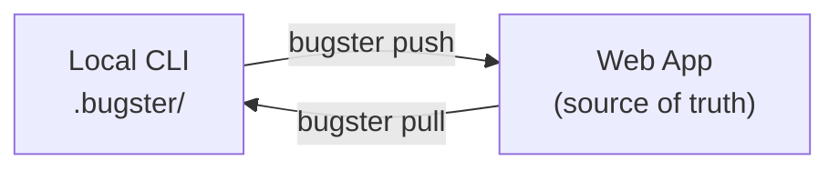

Bugster is a full platform that connects your local development environment with a collaborative web app. The **web app is the source of truth** for your test suite, while the **CLI** lets developers pull tests locally, edit them with coding agents, and push changes back.

This guide covers the complete workflow, from creating your first test to running suites across environments, and includes a migration path for existing CLI users.

## How Bugster Works

Bugster has two interfaces that work together:

| Interface | Who it's for | What it does |
| :--- | :--- | :--- |
| **Web App** | Everyone (QA, product, developers) | Create tests, organize suites, schedule runs, watch live execution, manage environments |
| **CLI** | Developers | Pull tests locally, edit with coding agents, run tests, push changes back |

<Info>
The web app is the single source of truth. Multiple team members can create and edit tests from either interface, and everything stays in sync through `bugster push` and `bugster pull`.
</Info>

## Creating Tests

You have three approaches to creating tests, depending on your role and preference.

### Option 1: Coding Agents (CLI)

Developers can use [Cursor](/guides/coding-agents/cursor) or [Claude Code](/guides/coding-agents/claude-code) to create and edit tests in YAML format with human-readable instructions. The workflow is:

<Steps>
<Step title="Pull your test suite">
  Bring the latest tests from Bugster into your local environment:

  ```bash
  bugster pull
  ```

  This creates (or updates) the `.bugster/` folder with all tests, configuration, and metadata.
</Step>

<Step title="Create or edit tests with your coding agent">
  Your coding agent can read and modify tests in the `.bugster/` folder. Tests are YAML files with natural language instructions that any developer can understand.

  <Tabs>
  <Tab title="Cursor">
  ```text
  @bugster-generate Create a test for the checkout flow
  ```

  ```text
  @bugster-update Update the login test to handle MFA
  ```
  </Tab>

  <Tab title="Claude Code">
  ```text
  @BUGSTER_GENERATE Create a test for the checkout flow
  ```

  ```text
  @BUGSTER_UPDATE Update the login test to handle MFA
  ```
  </Tab>
  </Tabs>

  <Tip>
  Install the coding agent rules first with `bugster plugin --agent cursor` or `bugster plugin --agent claude`. See the full setup in the [Cursor integration guide](/guides/coding-agents/cursor) or [Claude Code integration guide](/guides/coding-agents/claude-code).
  </Tip>
</Step>

<Step title="Run tests locally">
  Validate your tests before pushing:

  ```bash
  bugster run
  ```

  You can also run a quick one-off test in natural language:

  ```bash
  bugster run --quick "Verify the signup form validates email format"
  ```
</Step>

<Step title="Push changes">
  Sync your local test changes back to Bugster so they appear in the web app:

  ```bash
  bugster push
  ```
</Step>
</Steps>

### Option 2: Web App

QA engineers, product managers, and anyone on the team can create tests directly in the web app without touching a terminal. The web app includes an embedded browser so you can watch tests execute in real time.

There are three ways to create tests in the web app:

<AccordionGroup>
<Accordion title="Natural language prompt">
Describe what you want to test in plain English, just like asking an assistant. Bugster's AI agent interprets your intent and generates the test.

**Example prompt:**
> Test that a new user can sign up with email, verify their account, and see the onboarding wizard.
</Accordion>

<Accordion title="Structured instructions">
For more control, specify the task, steps, and expected result explicitly. This gives the agent precise guidance on what to do and what to verify.

**Example:**
- **Task:** Verify the password reset flow
- **Steps:**
  1. Navigate to the login page
  2. Click "Forgot password"
  3. Enter a registered email address
  4. Submit the form
- **Expected result:** A confirmation message appears saying "Reset link sent to your email"
</Accordion>

<Accordion title="Migrate from another platform">
If you already have a test suite in another test management platform (TestRail, Zephyr, qase, etc.), you can migrate your existing tests into Bugster. Reach out to the team and we can help you import your suite.
</Accordion>
</AccordionGroup>

### Option 3: CLI Quick Tests

Run one-off tests directly from the terminal using natural language, without creating a YAML file:

```bash
bugster run --quick "Check that the pricing page loads and shows three plan options"
```

This is useful for quick validation during development. See the [local development guide](/guides/local-development) for more patterns.

## Test Suites

Group related tests into suites for organized execution. Suites let you:

- **Run tests together** as a logical group (e.g., "Checkout flow", "Admin panel")
- **Schedule runs** on a recurring basis (daily, hourly, or custom)
- **Trigger from CI/CD** to run automatically on every deploy or pull request
- **Track results** across runs to spot regressions over time

Create and manage suites from the web app dashboard. Any test created from either the CLI or the web app can be added to a suite.

## Multi-App & Multi-Environment

Bugster supports testing flows that span multiple applications and environments.

| Concept | What it means |
| :--- | :--- |
| **Apps** | Different web applications in your organization (e.g., customer portal, admin dashboard) |
| **Environments** | Deployment targets for each app (e.g., staging, production, local) |

Define your apps and environments in the web app under **Settings**, then switch between them when running tests. This lets you:

- Run the same suite against staging before promoting to production
- Test cross-app flows that navigate between different URLs
- Maintain separate credentials per environment

## CLI and Web App Sync

The `push` and `pull` commands keep your local `.bugster/` folder and the web app in sync. This enables a collaborative workflow where multiple team members work on the same test suite.



- **`bugster pull`** downloads the latest suite from the web app into your local `.bugster/` folder
- **`bugster push`** uploads your local changes back to the web app
- Tests created in the web app appear locally after a pull
- Tests created or edited locally with coding agents appear in the web app after a push

<Warning>
Always pull before making local changes to avoid overwriting updates from other team members.
</Warning>

<Note>
The `.bugster/` folder can be added to `.gitignore` if you prefer not to commit tests to your repository. Since the web app is the source of truth, every developer can pull the latest suite with `bugster pull` at any time.
</Note>

## Migration Guide for Existing Users

If you're already using Bugster CLI, migrating to the full platform takes about 5 minutes.

<Steps>
<Step title="Update the CLI">
  Update to the latest version:

  <Tabs>
  <Tab title="macOS">
  ```bash
  curl -fsSL https://cli.bugster.dev/install | sh
  ```
  </Tab>

  <Tab title="Linux">
  ```bash
  curl -fsSL https://cli.bugster.dev/install | sh
  ```
  </Tab>

  <Tab title="Windows">
  ```powershell
  irm https://cli.bugster.dev/install.ps1 | iex
  ```
  </Tab>
  </Tabs>

  See the [installation guide](/installation) for details.
</Step>

<Step title="Push your tests to the web app">
  Sync your existing local tests to the Bugster web app:

  ```bash
  bugster push
  ```

  All your YAML tests from `.bugster/tests/` now appear in the web app dashboard.

  <Check>
  Verify your tests appear in the web app by opening the dashboard.
  </Check>
</Step>

<Step title="Set up Apps & Environments">
  Go to **Settings** in the web app and configure your apps and environments. Define at least one app with its base URL and one environment (e.g., staging).
</Step>

<Step title="Add testing credentials">
  If you haven't already, add your testing credentials in the web app under **Settings**. This ensures tests running from the web app can authenticate.

  <Note>
  If you already have credentials in your local `config.yaml`, they'll continue to work for CLI runs. Add them to the web app as well for web-based execution.
  </Note>
</Step>

<Step title="You're done">
  Your tests are now synced. You can continue using the CLI with coding agents, create tests in the web app, organize suites, and schedule runs.
</Step>
</Steps>

## Integrate Bugster CLI

If you're new to Bugster and want to start from the CLI, here's how to connect it to your development environment:

<Steps>
<Step title="Install the CLI">
  <Tabs>
  <Tab title="macOS">
  ```bash
  curl -fsSL https://cli.bugster.dev/install | sh
  ```
  </Tab>

  <Tab title="Linux">
  ```bash
  curl -fsSL https://cli.bugster.dev/install | sh
  ```
  </Tab>

  <Tab title="Windows">
  ```powershell
  irm https://cli.bugster.dev/install.ps1 | iex
  ```
  </Tab>
  </Tabs>
</Step>

<Step title="Authenticate">
  This opens a browser window for authentication, then pulls your `.bugster/` folder with all tests and creates rules for your coding agents.

  ```bash
  bugster auth
  ```
</Step>

<Step title="Initialize your project">
  Link Bugster to this project and set up your local test suite:

  ```bash
  bugster init --project-id your-project-id
  ```
</Step>

<Step title="Install coding agent rules">
  This installs Bugster-specific rules into your coding agent so it knows how to create and edit tests following the correct YAML structure and best practices.

  ```bash
  bugster plugin --agent cursor   # or --agent claude
  ```

  Once installed, your coding agent can read and modify tests in the `.bugster/` folder. Just ask it to create or update tests as needed. See the [Cursor integration guide](/guides/coding-agents/cursor) or [Claude Code integration guide](/guides/coding-agents/claude-code) for usage details.
</Step>

<Step title="Run, pull, and push">
  ```bash
  bugster run     # Execute tests locally
  bugster pull    # Bring the latest suite from the web app
  bugster push    # Sync local changes back to the web app
  ```
</Step>
</Steps>

## Next Steps

<CardGroup cols={3}>
<Card title="Cursor Integration" icon="text-slash" href="/guides/coding-agents/cursor">
  Set up Cursor as your test generation assistant
</Card>

<Card title="Claude Code Integration" icon="code" href="/guides/coding-agents/claude-code">
  Set up Claude Code for test generation
</Card>

<Card title="CI/CD Integration" icon="github" href="/guides/cicd/cicd-integration">
  Run tests automatically on every deploy
</Card>
</CardGroup>
